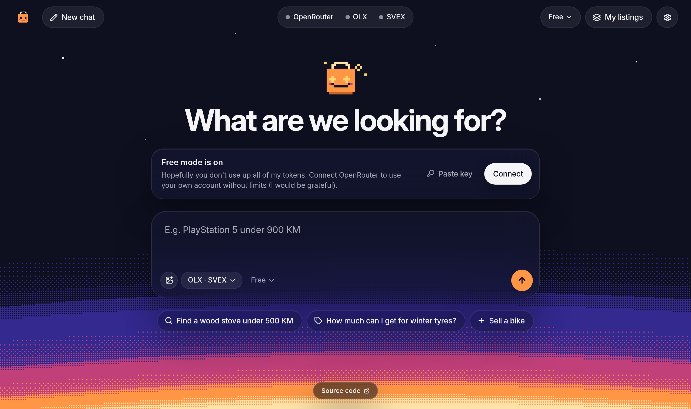

<div align="center">

# trgo

**Buy and sell on OLX.ba and SVEX.ba with a chat.**

[trgo.omarzunic.com](https://trgo.omarzunic.com)



</div>

trgo is an AI chat for two Bosnian marketplaces: OLX.ba and SVEX.ba. Tell Trgo, the mascot, what you want. Trgo searches both sites, tells you what an item is worth, and posts your listings.

## Features

- **Search**: one question searches OLX.ba and SVEX.ba. All results show as cards.
- **Price check**: Trgo reads hundreds of recent listings and removes accessories, wanted ads and bad prices. Then it shows the usual new and used price.
- **Sell**: send photos and a few facts. Trgo writes the listing, and you approve it before it goes live.
- **My listings**: see and edit your own OLX listings in the chat.
- **Free mode**: use the app with no account, with a daily limit. Connect OpenRouter for no limit and a choice of model.
- **Seven languages**: Bosnian, Croatian, Serbian, Slovenian, German, Bulgarian and English. The app uses the language of your system. You can change it in Settings.

## Privacy

Your data stays in your browser:

- The OpenRouter key stays in `localStorage` and goes only to OpenRouter.
- The OLX and SVEX logins keep only a session. The app does not keep your password.
- The proxy sends the marketplace requests. It does not write logs and does not keep request content.
- KupujemProdajem blocks Cloudflare. Its requests go through a small relay on the owner's home server. The relay also writes no logs.

The code is open source, so you can check this.

## Project layout

| Path | Content |
| --- | --- |
| `apps/shop` | The chat app (TanStack Start, React, Tailwind CSS v4) on Cloudflare Workers. |
| `apps/proxy` | The proxy for the marketplace requests and the free mode. |
| `packages/providers` | The OLX.ba and SVEX.ba provider code. |

## Run locally

```sh
bun install
bun run --cwd apps/shop dev
```

Open http://localhost:3000.

From `apps/shop`:

- `bun run typecheck`: check the types.
- `bun test`: run the tests.
- `bun run build`: make a production build.

To deploy, run `scripts/deploy.sh shop` or `scripts/deploy.sh proxy`. The script uses the `cf` CLI.

## License

MIT. See [`LICENSE`](LICENSE).
